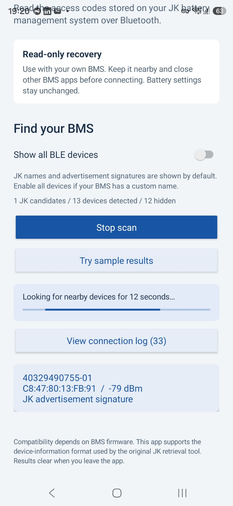
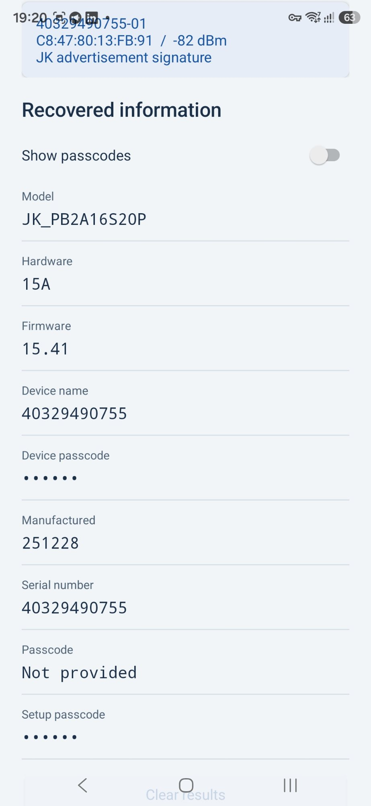

# JK BMS Recovery for Android

Read device information and recover access codes exposed by compatible JK (Jikong) battery management systems over Bluetooth Low Energy.

**[Download the Android APK](https://github.com/SapkaLabs/jk-bms-recovery-android/releases/latest)** · **[Installation and build guide](android/README.md)** · **[Protocol and compatibility notes](docs/PORTABILITY.md)**

## Features

- Native Android app for Android 8.0 and later.
- JK device discovery using advertised service/manufacturer signatures and JK-style names, with an all-devices override.
- Reads model, hardware, firmware, manufacture code, serial number and available passcode fields.
- Read-only device-information request; battery settings remain unchanged.
- Detailed live connection logs with raw BLE packets, GATT inventory, checksums and parser diagnostics. Copy logs or save them as a text file.
- Screenshots and screen recording are allowed throughout the app.
- No Internet permission, account, analytics or background service.

## Install

1. Download `JK-BMS-Recovery-1.0.2-debug.apk` from [Releases](https://github.com/SapkaLabs/jk-bms-recovery-android/releases/latest), then open it on your Android phone.
2. Wake your BMS, keep the phone nearby, and close other apps connected to the BMS.
3. Tap **Scan for devices** and allow Bluetooth access. Android 11 and earlier also require Location permission and the Location service for scanning.
4. Select your BMS. If it is missing, enable **Show all BLE devices**.
5. After the information appears, enable **Show passcodes** to reveal the available codes.

The APK is debug-signed and uses the same signing key as the earlier local builds. It can be installed over those versions. **Try sample results** displays synthetic data without a device connection.

Results clear when the app leaves the foreground. The connection log remains in process memory until cleared or the process exits. Raw logs can contain passcodes; copying or saving is an explicit user action.

## Screenshots

These screenshots were supplied by a user testing a real `JK_PB2A16S20P`, hardware `15A`, firmware `15.41`. They show JK-filtered discovery and decoded device information; passcodes are masked in the shared screenshot.

| Device discovery | Recovered information |
| --- | --- |
|  |  |

This provides user-reported evidence for that device and firmware. Other JK models and firmware may use different characteristics or information layouts.

## Diagnostics

Tap **View connection log** to see scan evidence, filter decisions, permission results, connection stages, GATT status codes, raw TX/RX bytes, frame/checksum details and field offsets. **Copy log** copies the current history; **Save .txt** opens Android's document picker.

The default discovery signature uses service `FFE0` plus manufacturer ID `0B65` or `4B4A`, following the [aiobmsble JK matcher](https://github.com/patman15/aiobmsble/blob/main/aiobmsble/bms/jikong_bms.py). JK names and explicitly labelled FFE0-only candidates are fallbacks. A MAC vendor prefix alone is not used to identify the BMS.

## Build

Install JDK 17, Android SDK Platform 36 and Build Tools 35.0.0, then set `ANDROID_HOME` to the SDK directory. Open `android/` in Android Studio or run:

```powershell
cd android
.\gradlew.bat :app:assembleDebug :app:testDebugUnitTest :app:lintDebug
```

On Linux/macOS, use `./gradlew` instead of `.\gradlew.bat`. The pinned Gradle wrapper verifies its distribution checksum. The APK is produced at `android/app/build/outputs/apk/debug/app-debug.apk`.

Version 1.0.2 passes 38 unit tests and Android lint with zero errors. See [the assessment](docs/PORTABILITY.md) for the scope and limits of validation.

## Source and provenance

The Android implementation is based on the device-information protocol in [ech0-py/jkbms_password_retrieve_tool](https://github.com/ech0-py/jkbms_password_retrieve_tool). The original Python files and Git history are retained, along with [the original upstream README](docs/UPSTREAM_README.md). The upstream tool credits [fl4p/batmon-ha](https://github.com/fl4p/batmon-ha).

See [NOTICE.md](NOTICE.md) for provenance and third-party license information. The inspected upstream revision did not contain a project license; this repository does not assert a project-wide relicensing of that material.
